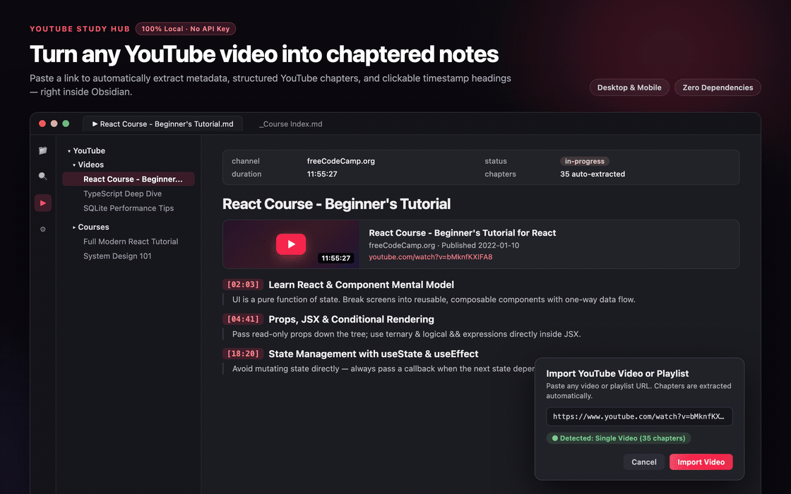

# YouTube Study Hub

> ⭐ If YouTube Study Hub helps you learn faster, a star on GitHub helps other learners find it. Found a bug or have an idea? [Open an issue](https://github.com/chi-li-peppers/obsidian-youtube-study-hub/issues).

[](https://github.com/chi-li-peppers/obsidian-youtube-study-hub/releases/latest)
[](https://github.com/chi-li-peppers/obsidian-youtube-study-hub/actions/workflows/ci.yml)
[](LICENSE)


Turn YouTube videos and playlists into structured study courses and chapter-based notes inside Obsidian — **100% local, free, and with zero API keys**.



## Features

- **Single video import with auto-chapters**: paste any `youtube.com/watch?v=…`, `youtu.be/…`, or `shorts/…` link to create a clean note with YAML metadata, optional video embed, and clickable chapter headings (`## [04:15] Chapter Name`) jumping straight to that timestamp.
- **Smart chapter fallback**: reads structured YouTube chapter markers first, falls back to parsing timestamps from the video description, and creates a clean `## Notes` section if a video has no chapters.
- **Playlist to course converter**: paste any public or unlisted playlist URL to generate a dedicated course folder with:
  - numbered lesson notes (`01 - Lesson Title.md`, `02 - …`) linking back to the course index;
  - `_Course Index.md` with a live **progress bar** (`<progress>`) and lesson checklist that updates automatically when you tick off lessons;
  - rate-limit safe toggle: create lightweight lesson notes instantly (and fetch chapters for any lesson later with a command), or fetch all chapters upfront with a polite delay.
- **Customizable themes**: automatically adapts to Obsidian light & dark modes, plus built-in accent presets (**Obsidian Accent**, **YouTube Crimson**, **Electric Violet**, and **Emerald Study**).
- **Safe duplicate handling**: never overwrites existing notes — prompts you to open the existing file or create a separate copy.
- **Zero API keys, works on desktop & mobile**: uses Obsidian's built-in `requestUrl` with no external binaries (`yt-dlp`, `ffmpeg`) or backend servers.

## Commands

| Command | What it does |
| --- | --- |
| Import YouTube video & chapters | Opens the import modal for a single video |
| Import YouTube playlist as course | Opens the import modal to turn a playlist into a course folder |
| Fetch chapters for active video note | Fetches and appends YouTube chapters to the open video/lesson note |

## Installation

### From source (development)
```bash
npm install
npm run build
```
Copy `main.js`, `manifest.json`, and `styles.css` into `<vault>/.obsidian/plugins/youtube-study-hub/` and enable **YouTube Study Hub** in **Settings → Community plugins**.

### From GitHub Releases
Download `main.js`, `manifest.json`, and `styles.css` from the [latest release](../../releases/latest) into `<vault>/.obsidian/plugins/youtube-study-hub/`.

## Privacy

YouTube Study Hub makes requests **only** to `youtube.com` when you explicitly trigger an import. No analytics, telemetry, API keys, or third-party servers are used.

## Support

If this plugin saves you time while studying from YouTube, consider supporting development on [Patreon](https://www.patreon.com/YOUR_USERNAME) or starring the repository.

## License

[MIT](LICENSE) © 2026 David ([chi-li-peppers](https://github.com/chi-li-peppers))
